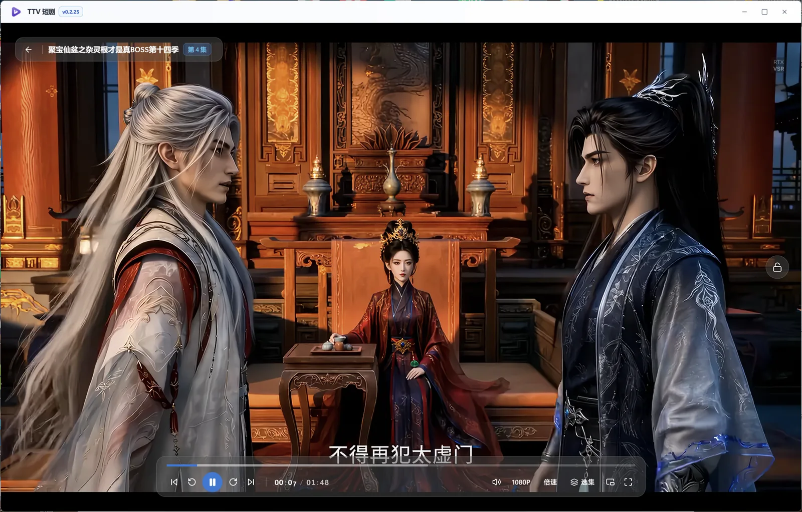
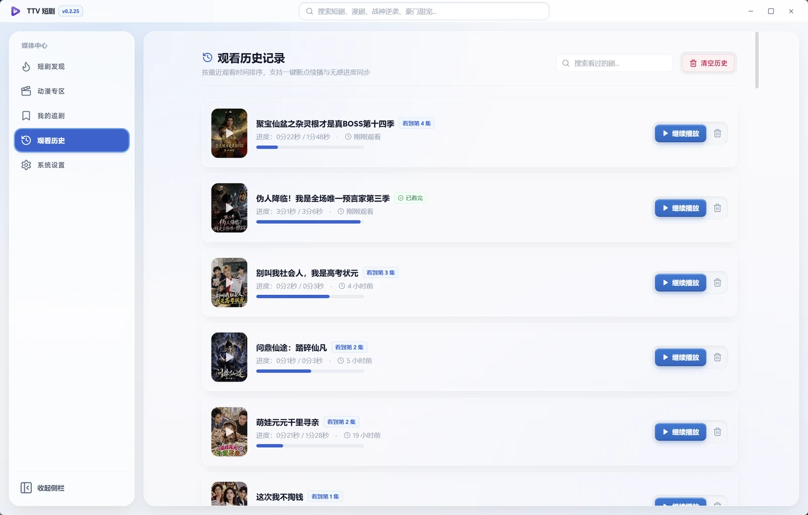

<p align="center">
  
</p>

<h1 align="center">TTV Short Drama</h1>

<p align="center">
  <strong>支持 Windows 与 macOS 的短剧、漫剧与动漫桌面播放器</strong><br />
  一处发现想看的剧，从上次停下的地方接着看。
</p>

<p align="center">
  <a href="https://github.com/kiocou/TTV-Short-Drama/releases">
    
  </a>
  
  
  
  <a href="./LICENSE">
    
  </a>
</p>

<p align="center">
  
</p>

## 想看的剧，在一个地方找到

打开 TTV，短剧、漫剧与动漫都在同一个桌面客户端里。按题材浏览、切换频道、搜索剧名，也可以从热播与上新里随手挑一部。

- **多频道浏览**：短剧、漫剧、动漫各自成区，分类与排序随手切换。
- **搜索与筛选**：输入剧名或题材，快速缩小范围；搜索记录随时找回。
- **剧集详情**：封面、简介、标签与完整选集一目了然，想看哪集点哪集。
- **猜你喜欢**：详情页底部按季接续推荐，看第 5 季就先排后续的 6、7、8 季。
- **追剧与历史**：收藏在追的剧，自动记录观看进度，下次打开直接续播。

<p align="center">
  
</p>

## 看得舒服，也看得顺手

播放器把常用操作放在画面上，不打断观看。控制栏、选集、清晰度、倍速与全屏都能随手切换。

- **沉浸播放**：无边框窗口与悬浮控制栏，画面就是主角。
- **清晰度与倍速**：按当前剧集可用的档位选择清晰度，自由切换播放速度。
- **自动连播**：本集结束前出现倒计时，平滑进入下一集。
- **键盘操作**：空格暂停、方向键快进快退、`[` / `]` 切集、`F` 全屏。
- **长按加速**：按住方向键临时加速，松开回到原速，不改变播放位置。
- **操作提示**：按快捷键时画面中央即时反馈当前操作（音量百分比、快进落点时间、切到第几集）。
- **画中画小窗**：置顶小窗继续播放，主窗口可以同时浏览其他内容。

<p align="center">
  
</p>

## 回来时，从上次停下的地方继续

观看记录会自动保存每一部剧看到哪一集、看到哪里。回看、换集或重新打开应用，都不用再找进度。

- **断点续播**：继续播放按钮直接回到上次的位置。
- **观看历史**：按最近观看排序，支持搜索与清理。
- **追剧收藏**：把想追的剧收在一起，更新与进度清楚可见。
- **本地缓存**：看过的剧集留在本机，回看更顺畅；空间不足时自动清理旧缓存。

<p align="center">
  
</p>

## 按自己的习惯使用

浅色、暗色或跟随系统，播放与缓存偏好都能在设置里调整。

- **主题外观**：浅色、暗色、跟随系统三种选择。
- **播放偏好**：默认清晰度、自动连播与启动音效均可单独开关。
- **存储管理**：查看缓存占用，按需清空缓存。
- **网络诊断**：设置页可检测系统代理与目录链路，定位「目录加载失败」。

<p align="center">
  
</p>

## 更新下载

应用内即可检查并安装新版本，下载环节针对国内网络做了优化：

- **自动选路**：下载前先检测 GitHub 是否可正常访问 —— 可访问走直连，不可访问或过慢则自动切换国内加速通道。
- **分片并发**：按分片并发拉取安装包，明显快于单连接下载。
- **完整性校验**：下载完成后比对 GitHub 官方公布的 SHA-256，校验不通过会删除文件并提示。
- **两步确认**：下载完成先询问是否关闭程序，确认后再启动安装向导，不打断你手上的事。

## 下载与安装

前往 [GitHub Releases](https://github.com/kiocou/TTV-Short-Drama/releases) 选择对应系统与芯片架构的安装包：

| 平台 | CPU 架构 | 安装包后缀 | 说明 |
|---|---|---|---|
| Windows 10 / 11 | x64 (`x86_64`) | `*-x64-setup.exe` | 完整功能（含独立 MPV 播放器、补帧及全部内置源） |
| Windows 11 | ARM64 (`aarch64`) | `*-arm64-setup.exe` | 原生 ARM64 主程序，内置播放器与 Rust 原生源全功能 |
| macOS | Apple Silicon (`M` 系列 / `aarch64`) | `*_aarch64.dmg` | 原生 Apple Silicon 安装镜像，使用内置播放器播放 |
| macOS | Intel (`x64`) | `*_x64.dmg` | Intel Mac 安装镜像，使用内置播放器播放 |

应用内「检查更新」会自动识别当前系统与架构并下载对应的 `.exe` 或 `.dmg` 安装包。

## 从源码构建

本公开源码仓库仅包含应用前后端、原生播放器及适配层源代码，**不包含**第三方预编译运行库二进制（如 `ffmpeg.exe`、`libmpv-2.dll`、嵌入式 CPython 及闭源 DLL）。

```bash
# 安装前端依赖并检查类型与构建
npm ci
npm run build

# 运行 Rust 后端与原生播放器单元测试
cargo test --manifest-path src-tauri/Cargo.toml --bins
cargo test --manifest-path src-tauri/ttv-player/Cargo.toml

# 构建桌面安装包（macOS 使用专用配置）
npx tauri build
# macOS: npx tauri build --config src-tauri/tauri.macos.conf.json
```

> 如需在 Windows 本地启用依赖外部运行库的完整转码增强或独立 MPV 窗口，请按 [`THIRD-PARTY-NOTICES.md`](./THIRD-PARTY-NOTICES.md) 说明自行准备对应运行库文件放到 `src-tauri/native-player/` 与 `src-tauri/resources/`。

## 已知边界（做不到 vs 还没做）

有些能力看起来缺失，实际是**数据源不提供**或**平台/硬件上限**。列在这里，免得被当成待办反复重开：

| 项 | 情况 | 原因 |
|---|---|---|
| 清晰度档位选择 | 不提供 | 部分上游链路只给一路码流，没有并列档位可选；多做下拉框只会是个改了没反应的开关 |
| 播放来源切换 | 不提供 | 一部剧只有一条能出流的解析链路，"哪个源能播"由解析结果决定，不由用户选 |
| 独立 MPV / 补帧 / 增强引擎 | 仅 Windows | 独立 `ttv-player`（`libmpv-2.dll`）、LSFG GPU 补帧与 RTX VSR 依赖 Windows 图形管线；macOS 自动使用内置 WebView 播放器 |
| Windows x64 专属 DLL 源 | 仅 Windows x64 | 个别外部闭源 DLL 桥接仅提供 Windows x64 二进制；macOS 与 Windows ARM64 自动走纯 Rust 原生源与兜底源，不影响核心追剧与播放 |
| 补帧倍率上限 | 受硬件约束 | 2X/3X/4X/5X 都会生成对应数量的中间帧，但实际输出帧率受显示器刷新率与 GPU 时间限制；界面与日志显示的是**实测倍率**，不是用户选的值 |
| 目录缓存占用 | 已实现 | 设置页显示的是现场扫描缓存目录得到的真实字节数（不是设置里那个恒为 0 的历史字段） |

## 使用说明

- 本应用仅提供播放器与本地管理功能，不存储、不托管、不传播任何视频内容。
- 剧集信息与媒体内容来自第三方，版权归各自权利人所有。
- 请仅将本应用用于个人合法用途，并遵守所在地区的法律法规。

## 致谢

感谢以下开源项目与社区在协议研究、桌面端能力与社区交流方面提供的帮助：

- **[beilunyang/openhongguo](https://github.com/beilunyang/openhongguo)**（Apache-2.0）：红果协议 Rust 客户端实现（`src-tauri/src/hongguo/`）的协议语义参考与移植基线
- **[Tauri](https://github.com/tauri-apps/tauri)** / **[React](https://github.com/facebook/react)** / **[Vite](https://github.com/vitejs/vite)** / **[Tailwind CSS](https://github.com/tailwindlabs/tailwindcss)**：跨平台桌面框架与前端构建技术栈
- **[mpv](https://github.com/mpv-player/mpv)** / **[FFmpeg](https://github.com/FFmpeg/FFmpeg)** / **[hls.js](https://github.com/video-dev/hls.js)** / **[lucide](https://github.com/lucide-icons/lucide)**：视频播放渲染、转码补帧与界面图标支持
- **[bogdanfinn/tls-client](https://github.com/bogdanfinn/tls-client)** / **[bogdanfinn/fhttp](https://github.com/bogdanfinn/fhttp)**：站源网络适配工具库
- **[yangbin1322/hongguo-player](https://github.com/yangbin1322/hongguo-player)**：公开分发仓库结构与发布文档组织参考
- 感谢 **[linuxdo](https://linux.do/)** 社区的交流、分享与反馈

## 许可

本项目源码采用 **[PolyForm Noncommercial License 1.0.0](./LICENSE)**（非商业开源协议）发布：

- 允许出于**个人学习、技术研究、试验与非商业用途**阅读、修改与免费分发源码；
- **严禁任何形式的商业使用、收费分发或用于盈利性产品与服务**；
- 第三方组件许可证与归属声明见 [`THIRD-PARTY-NOTICES.md`](./THIRD-PARTY-NOTICES.md)。
