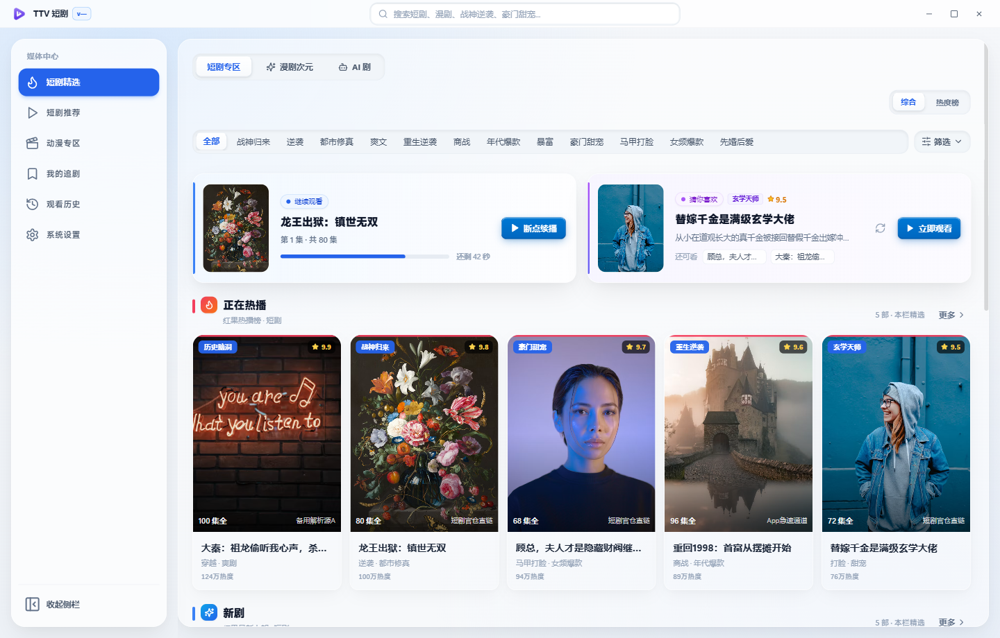
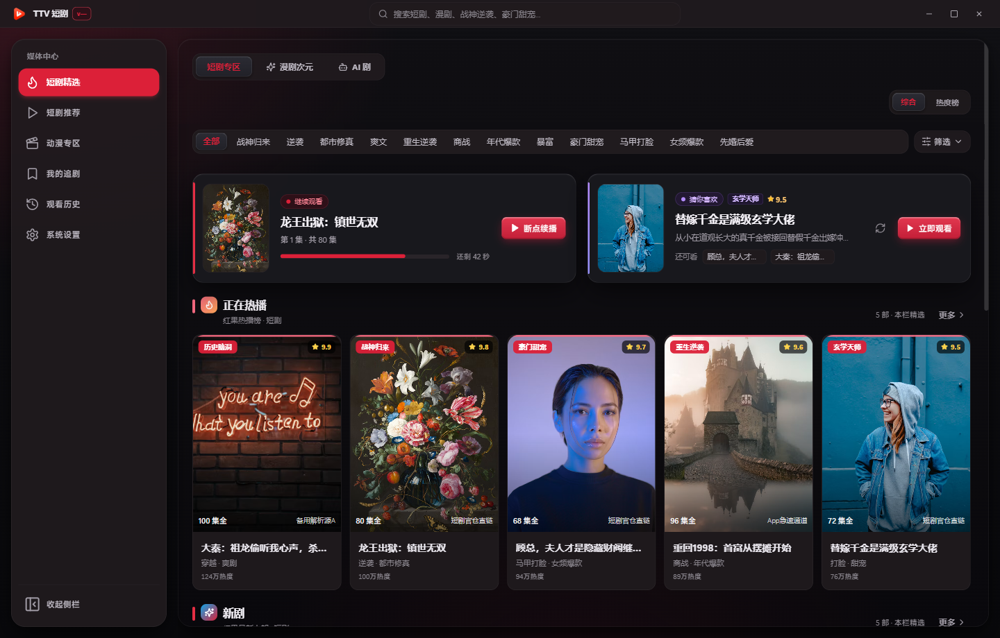
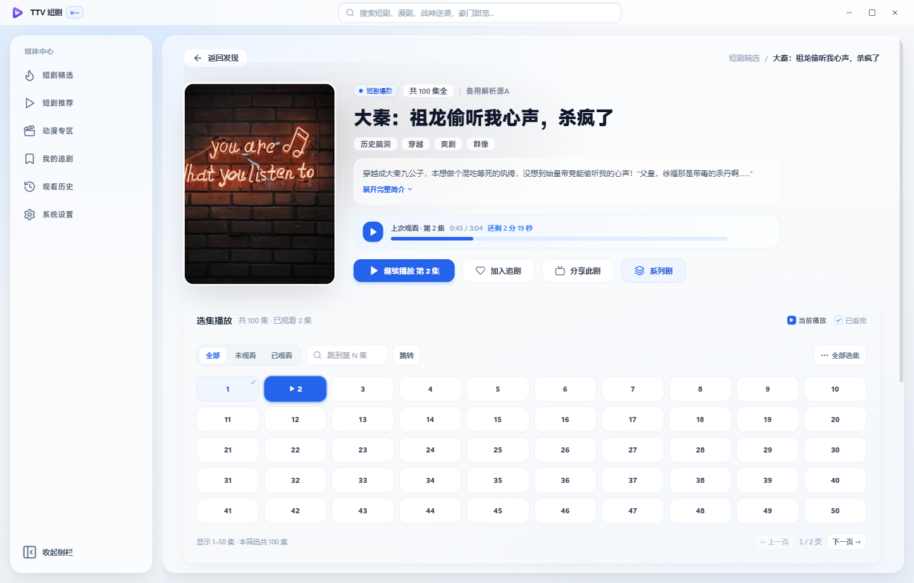
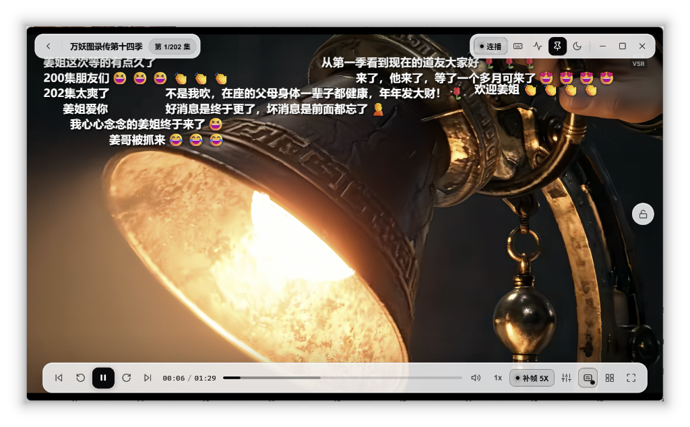
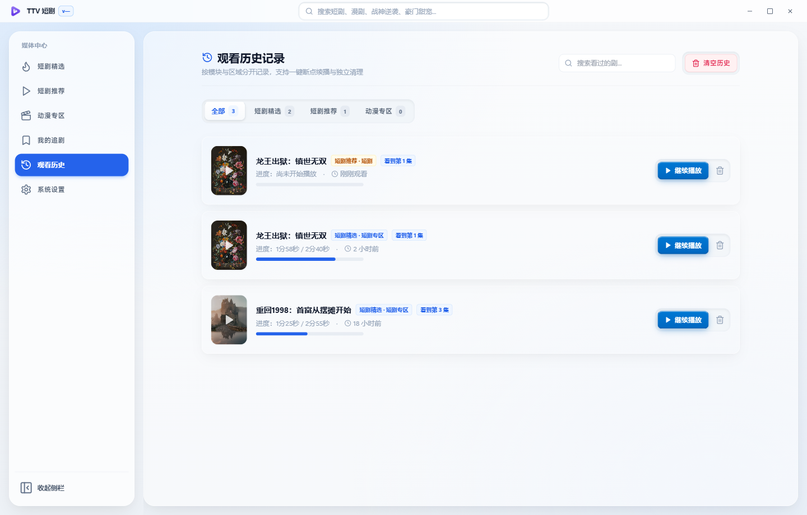
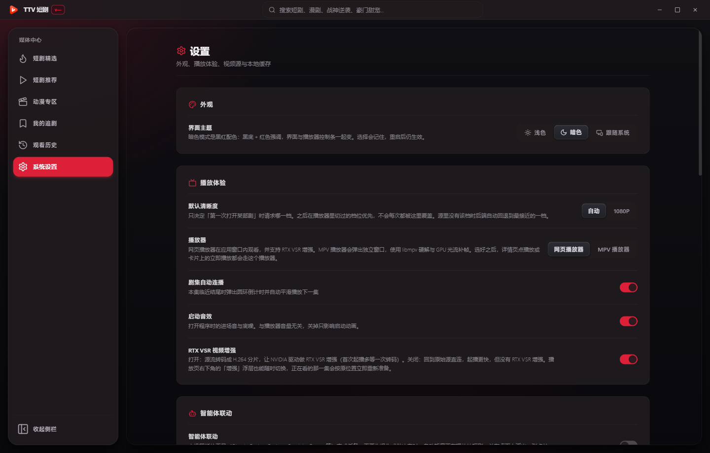

<p align="center">
  
</p>

<h1 align="center">TTV Short Drama Source</h1>

<p align="center">
  <strong>TTV Short Drama 公开非商用源码仓库（Tauri 2 + React 19 + Rust + 独立 MPV 播放器）</strong><br />
  已完成本机隐私脱敏与第三方预编译二进制剥离，供个人学习与非商业技术研究使用。
</p>

<p align="center">
  <a href="https://github.com/kiocou/TTV-Short-Drama-Source/actions/workflows/ci.yml">
    
  </a>
  <a href="./LICENSE">
    
  </a>
  
  <a href="https://github.com/kiocou/TTV-Short-Drama/releases">
    
  </a>
</p>

## 界面效果预览

| 浅色模式 · 短剧精选 | 暗色模式 · 短剧精选 |
|---|---|
|  |  |
| **剧集详情与分段选集** | **独立 MPV 播放器（5X 补帧 + 弹幕）** |
|  |  |
| **观看历史与断点续播** | **系统设置（暗色）** |
|  |  |

## 仓库架构

```text
├── src/                      前端应用（React 19 + TypeScript + Vite + Tailwind CSS + hls.js）
│   ├── views/                短剧精选 / 竖滑推荐 / 动漫专区 / 追剧 / 历史 / 搜索 / 详情 / 设置
│   ├── player/               内置播放器控制栏、弹幕层、进度条、迷你条与画中画桥接
│   ├── stores/               播放、推荐流、历史、追剧、设置与智能体状态管理
│   └── services/             IPC 封装、续播逻辑、季标签解析、HLS 挂载与路由契约
├── src-tauri/src/            Tauri 2 + Rust 后端
│   ├── provider.rs           统一内容源接口与网页公开检索
│   ├── hongguo/              纯 Rust 红果协议栈（签名 / 设备注册 / 目录 / 播放模型 / 弹幕）
│   ├── huangguo/             边缘信封客户端与 AES-128-CBC 封面解密
│   ├── anime_provider.rs     动漫多源调度与桥接适配
│   ├── hls_proxy.rs          本地回环 HLS 代理（分片并发预取与加密重写）
│   ├── media_enhance.rs      H.264 / RTX VSR 转码与按集持久化缓存
│   ├── native_player.rs      独立 MPV 播放器进程与双工命名管道宿主通信
│   ├── storage.rs            SQLite（观看历史 / 追剧 / 设置持久化）
│   ├── update.rs             跨平台 GitHub Releases 检查、镜像择优与分片并发更新
│   └── agent_*               本地 AI 智能体联动（Hook 事件上报与独立悬浮窗）
├── src-tauri/ttv-player/     独立 MPV 播放器子工程（Rust + DirectComposition + WebView2 HUD + HLSL GPU 光流补帧）
├── src-tauri/guo-core/       Go 多站源适配源码
├── scripts/                  一致性检查与前端/协议静态及单元测试（verify:*）
└── .github/workflows/        跨平台 CI（Ubuntu 前端校验 + Windows x64/ARM64 + macOS ARM64/x64 编译测试）
```

## 源码公开与隐私隔离说明

- **无历史干净仓库**：以单次初始化提交发布，不包含维护者本地提交历史与私人邮箱。
- **剔除本机隐私与非项目文件**：移除 `AGENTS.md`、本机绝对路径硬编码、运行期 `.app-data/` / SQLite / 调试日志及研究分析草稿目录。
- **不含预编译第三方二进制**：已剔除 `ffmpeg.exe`（GPLv3）、`libmpv-2.dll`、嵌入式 `python/`、`site-packages/` 及闭源 DLL 等运行库（`src-tauri/native-player/`、`src-tauri/resources/{mpv,guo-core,python,ttv-player}/` 保留目录占位）；桌面终端用户可直接前往 **[`kiocou/TTV-Short-Drama`](https://github.com/kiocou/TTV-Short-Drama/releases)** 下载预编译安装包。

## 从源码构建与验证

### 环境要求

- **Node.js 22+**（脚本测试依赖 `--experimental-strip-types`）
- **Rust Stable Toolchain**（`rustfmt` + `clippy`；macOS 构建需 Xcode Command Line Tools）

### 构建与测试命令

```bash
# 1. 安装前端依赖、执行 TypeScript 类型检查与 Vite 打包
npm ci
npm run build

# 2. 运行前后端契约与逻辑验收脚本
npm run verify:huangguo
npm run verify:native-player
npm run verify:playback-routing

# 3. 运行 Rust 后端与独立播放器测试（不依赖预编译二进制即可通过）
cargo fmt --manifest-path src-tauri/Cargo.toml --check
cargo clippy --manifest-path src-tauri/Cargo.toml --all-targets -- -D warnings
cargo test --manifest-path src-tauri/Cargo.toml --bins
cargo clippy --manifest-path src-tauri/ttv-player/Cargo.toml --all-targets -- -D warnings
cargo test --manifest-path src-tauri/ttv-player/Cargo.toml

# 4. 构建桌面端安装包
# Windows:
npx tauri build --bundles nsis
# macOS (使用专用精简配置):
npx tauri build --config src-tauri/tauri.macos.conf.json --bundles dmg
```

> 若要在 Windows 本地完整启用 `ttv-player` 独立 MPV 窗口或 FFmpeg 转码增强，请参考 [`THIRD-PARTY-NOTICES.md`](./THIRD-PARTY-NOTICES.md) 自行准备对应运行库文件放入 `src-tauri/native-player/` 与 `src-tauri/resources/`（可设置 `TTV_REQUIRE_RUNTIME_BINS=1` 开启强校验）。

## 开源协议（非商用）

本项目自有前后端与播放器源码采用 **[PolyForm Noncommercial License 1.0.0](./LICENSE)** 发布：

- ✅ 允许个人学习、技术研究、试验、非商业改编与免费共享；
- ❌ **禁止任何商业使用、付费销售、商业 SaaS/服务打包或变相盈利行为**；
- 📄 第三方组件许可证与 Apache-2.0（`beilunyang/openhongguo`）等归属声明见 [`THIRD-PARTY-NOTICES.md`](./THIRD-PARTY-NOTICES.md)。

## 致谢

- **[beilunyang/openhongguo](https://github.com/beilunyang/openhongguo)**（Apache-2.0）：红果协议 Rust 客户端实现（`src-tauri/src/hongguo/`）的协议语义参考与移植基线
- **[Tauri](https://github.com/tauri-apps/tauri)** / **[React](https://github.com/facebook/react)** / **[Vite](https://github.com/vitejs/vite)** / **[Tailwind CSS](https://github.com/tailwindlabs/tailwindcss)**
- **[mpv](https://github.com/mpv-player/mpv)** / **[FFmpeg](https://github.com/FFmpeg/FFmpeg)** / **[hls.js](https://github.com/video-dev/hls.js)** / **[lucide](https://github.com/lucide-icons/lucide)**
- **[bogdanfinn/tls-client](https://github.com/bogdanfinn/tls-client)** / **[bogdanfinn/fhttp](https://github.com/bogdanfinn/fhttp)** / **[yangbin1322/hongguo-player](https://github.com/yangbin1322/hongguo-player)**
- 感谢 **[linuxdo](https://linux.do/)** 社区的交流与反馈
